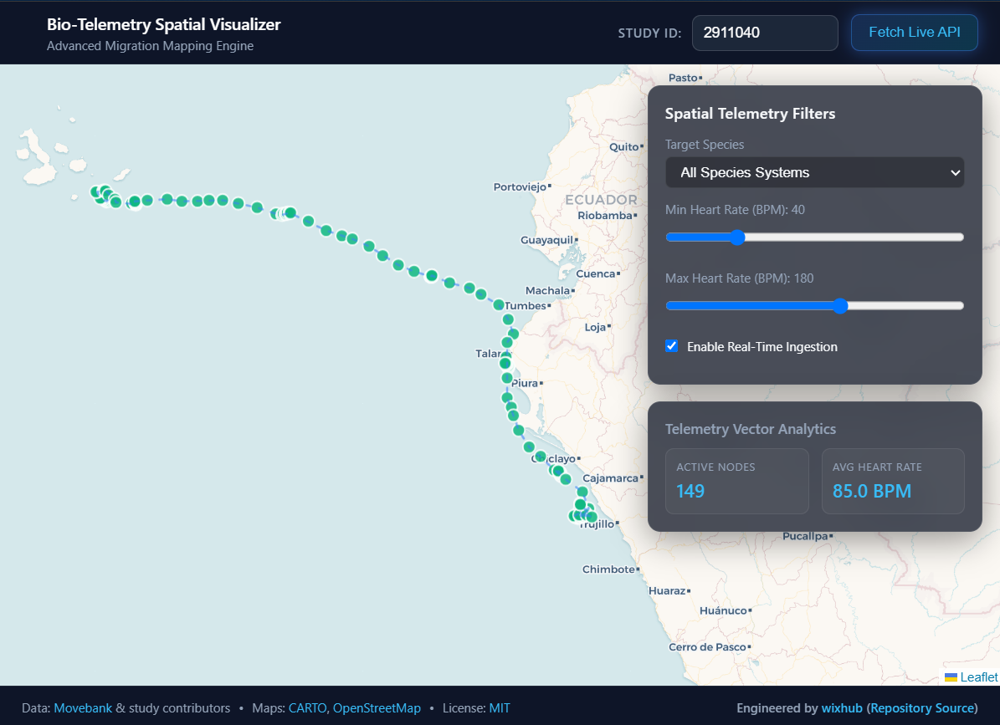

# 🧬 Bio-Telemetry Spatial Visualizer

The spatial rendering engine for migratory animal tracking data, engineered for ecological metadata management and reactive spatial filtering. A high-performance Angular dashboard designed to visualize biological telemetry data from the **Movebank API**, built as a reactive, user-friendly replacement for legacy tracking interfaces.

This app is a part of the [@ecosystem](../../README.md) monorepo.

## 🏛️ Architecture Overview

The application is built as an enterprise-grade Angular single-page application leveraging architecture (Signals, RxJS and standalone components) alongside Leaflet for spatial mapping. It utilizes zoneless change detection to maximize frame-rate performance for high-frequency Leaflet GIS canvas rendering and real-time telemetry streaming.

## ⚡ Key Technical Pillars

- **Signals & Computed Reactivity**: Fine-grained state synchronization using Angular Signals (`signal`, `computed`, `effect`) and seamless RxJS bridging via `toSignal()`.

- **Standalone Components**: Strict modular standalone architecture optimized with lazy-loaded deferrable views (`@defer (on idle)`).

- **GIS Map Encapsulation**: Decoupled Leaflet integration managed via enterprise services with rigorous `DestroyRef` memory cleanup lifecycles.

## 🚀 Live Demo

🔗 **[View Live Application on Cloudflare Pages](https://bio-stream.pages.dev)**



## 🌐 Data Source & Backend Proxy

- **Cloudflare Worker Integration**: The application utilizes a dedicated serverless worker as an online data source and API proxy. It securely fetches live telemetry streams from the Movebank API, handles CORS limitations and parses raw CSV responses into strongly-typed data models.

- **Backend Endpoint**: 🔗 **[View Worker on Cloudflare Workers](https://wispy-surf-c9db.rublin.workers.dev/)**

- **Data Attribution**: Telemetry data is accessed via the **[Movebank API](www.movebank.org)** and provided by individual study contributors. Map tiles are powered by **CARTO** under CC BY 3.0, utilizing data from **OpenStreetMap** contributors.

## 🌟 Key Features

- **Interactive Leaflet Mapping**: Real-time rendering of spatial coordinates, color-coded species markers and movement tracking polylines.

- **Dual Data Sources**: Seamlessly switch between local static mock data (`telemetry-mock.json`) and live telemetry feeds from Movebank via a custom Cloudflare Worker proxy (`wispy-surf-c9db.rublin.workers.dev`).

- **Multi-Study Support**: Easily toggle between public research studies (e.g., Northern Elephant Seals, Galapagos Albatrosses, Galapagos Tortoises) right from the UI HUD.

- **Robust Error Handling & Fallbacks**: Automated fallback mechanisms if upstream Movebank API requests experience timeouts or rate limits (HTTP 522 Cloudflare errors).

- **Advanced Filtering & Analytics**: Filter streams dynamically by species classifications (`AVIAN_MIGRATORY`, `MARINE_CETACEAN`, `TERRESTRIAL_UNGULATE`) and physiological thresholds (Heart Rate ranges).

## 🛠️ Core Services & Components

- **`LeafletMapService`**: Manages the Leaflet map lifecycle, layer groups, custom circle markers, popups and polyline vectors.

- **`TelemetryStreamService`**: Handles HTTP communication with the Cloudflare Worker proxy, CSV parsing into strongly-typed telemetry models and fallback logic.

- **`MapContainer`**: The master orchestration container combining HUD controls, reactive stream routing and analytics components.

## Project Structure

```text
bio-stream/
    ├── public/
    │ └── data/
    │ └── telemetry-mock.json
    ├── src/
    │ ├── app/
    │ │ ├── features/
    │ │ │ ├── map-container/
    │ │ │ │ ├── map-container.component.ts
    │ │ │ │ ├── map-container.component.html
    │ │ │ │ └── map-container.component.scss
    │ │ │ ├── telemetry-filters/
    │ │ │ │ ├── telemetry-filters.component.ts
    │ │ │ │ ├── telemetry-filters.component.html
    │ │ │ │ └── telemetry-filters.component.scss
    │ │ │ └── telemetry-analytics/
    │ │ │ ├── telemetry-analytics.component.ts
    │ │ │ ├── telemetry-analytics.component.html
    │ │ │ └── telemetry-analytics.component.scss
    │ │ ├── app.config.ts
    │ │ ├── app.ts
    │ │ └── app.html
    │ ├── styles.scss
    │ └── main.ts
    ├── angular.json
    ├── package.json
    └── README.md
```

## 🛠️ Getting Started

For installation instructions and prerequisites, see the **Getting Started** section of [@ecosystem](../../README.md).

## ⚙️ Configuration & Environment

To run this application locally, you need to provide configuration keys for map tiles [CARTO](https://carto.com/basemaps/apikey/).

1. Copy the example environment configuration file located in `libs/config/src/`:

```bash
cp libs/config/src/carto.config.example.ts libs/config/src/carto.config.ts
```

2. Open `libs/config/src/carto.config.ts` and insert your personal CARTO API key:

```typescript
export const CARTO_API_KEY = 'YOUR_CARTO_API_KEY';
```

> [!NOTE]
> `carto.config.ts` is ignored by Git to keep API keys secure, while `carto.config.example.ts` serves as the public template.

## Development

To run this application locally for development, use the Nx task runner from the repository root:

```bash
# Run development server with live reload
npx nx serve bio-stream

# Or run it with a specific configuration
npx nx serve bio-stream --configuration=production
```

## Build

To build the production bundle for this specific application:

```bash
npx nx build bio-stream
```

## Testing

```bash
# Run unit tests
npx nx test bio-stream

# Run lint checks
npx nx lint bio-stream
```

## 🤝 Contributing

Contributions, issues and feature requests are welcome! Feel free to check the [issues page](hhttps://github.com/wixhub/ecosystem/issues).

## 📬 Contact & Support

If you have any questions, suggestions, or feedback regarding this project, feel free to reach out:

- **Author:** [@wixhub](https://github.com/wixhub)
- **Telegram:** [@typeweb](https://t.me/typeweb)

## ⚖️ License & Attribution

- **Software License**: This project is open-source software licensed under the [**MIT License**](../../LICENSE).

- **Data & Map Attribution**:
  - Animal tracking data provided by [**Movebank**](www.movebank.org) and individual researchers.

  - Map tiles by [**CARTO**](https://carto.com/), under CC BY 3.0. Data by **OpenStreetMap** contributors.
