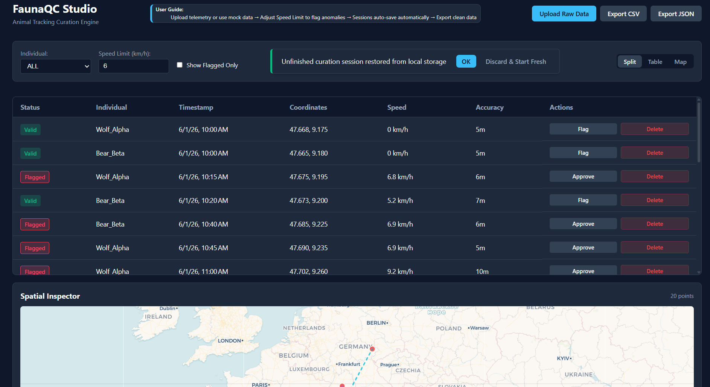

# FaunaQC Studio <br/> Movebank Data Curation & Quality Control Tool

An interactive, high-performance web application built with Angular 22 (Signals/Effects) designed to help researchers inspect, clean and validate raw animal tracking data prior to analysis or repository publication.

This app is a part of the [@ecosystem](../../README.md) monorepo.

## Features

- **Granular Geospatial QC Engine**: Calculates movement metrics independently per animal (GeospatialQcEngine), preventing cross-individual speed calculation errors and flagging physical anomalies or GPS inaccuracies.

- **Session Auto-Save & Restoration**: Automatically persists curation state, manual overrides, and filter configurations to IndexedDB via Dexie.js, complete with an integrated session restoration workflow.

- **Deterministic Map Visualization**: Integrates Leaflet.js to render segmented paths with distinct, consistent color-coding per animal subject alongside interactive popup telemetry inspectors.

- **Adaptive UI & Layout**: Utilizes SCSS and CSS Grid to transform split-screen data management tools into fluid, mobile-friendly interfaces across devices.

- **Interactive Review & Export**: Visually inspect anomalies, toggle data inclusion status via manual overrides, and export cleaned datasets locally as CSV or JSON formats.

## Tech Stack

- **Framework:** This project was generated using [Angular CLI](https://github.com/angular/angular-cli) version 22.1.3 (Signals, Effects, Functional Inputs/Outputs)

- **Persistence**: Dexie.js (IndexedDB)

- **Styling:** SCSS, CSS Grid (Fully Responsive Across All Screens)

- **Mapping & Logic:** Leaflet.js with CARTO basemaps integration, custom data-processing pipes



## 🚀 Live Demo

🔗 **[View Live Application on Cloudflare Pages](https://data-curation.pages.dev/)**

### User Guide:

1. Upload a raw telemetry dataset using **Upload Raw Data** or inspect the preloaded mock records.
2. Adjust the **Speed Limit** to automatically flag physical anomalies, review points in the table or spatial inspector.
3. Your session is **auto-saved**, allowing you to seamlessly continue editing after a reload.
4. Export your cleaned dataset for repository publication.

## 🛠️ Getting Started

For installation instructions and prerequisites, see the **Getting Started** section of [@ecosystem](../../README.md).

## ⚙️ Configuration & Environment

To run this application locally, you need to provide configuration keys for map tiles [CARTO](https://carto.com/basemaps/apikey/).

1. Copy the example environment configuration file located in `libs/config/src/`:

```bash
cp libs/config/src/carto.config.example.ts libs/config/src/carto.config.ts
```

2. Open `libs/config/src/carto.config.ts` and insert your personal CARTO API key:

```typescript
export const CARTO_API_KEY = 'YOUR_CARTO_API_KEY';
```

> [!NOTE]
> `carto.config.ts` is ignored by Git to keep API keys secure, while `carto.config.example.ts` serves as the public template.

## Development

To run this application locally for development, use the Nx task runner from the repository root:

```bash
# Run development server with live reload
npx nx serve data-curation

# Or run it with a specific configuration
npx nx serve data-curation --configuration=production
```

## Build

To build the production bundle for this specific application:

```bash
npx nx build data-curation
```

## Testing

```bash
# Run unit tests
npx nx test data-curation

# Run lint checks
npx nx lint data-curation
```

## 🤝 Contributing

Contributions, issues and feature requests are welcome! Feel free to check the [issues page](hhttps://github.com/wixhub/ecosystem/issues).

## 📬 Contact & Support

If you have any questions, suggestions, or feedback regarding this project, feel free to reach out:

- **Author:** [@wixhub](https://github.com/wixhub)
- **Telegram:** [@typeweb](https://t.me/typeweb)

## ⚖️ License & Attribution

- **Software License**: This project is open-source software licensed under the [**MIT License**](../../LICENSE).

- **Map Attribution**:
  - Map tiles by [**CARTO**](https://carto.com/), under CC BY 3.0. Data by **OpenStreetMap** contributors.
