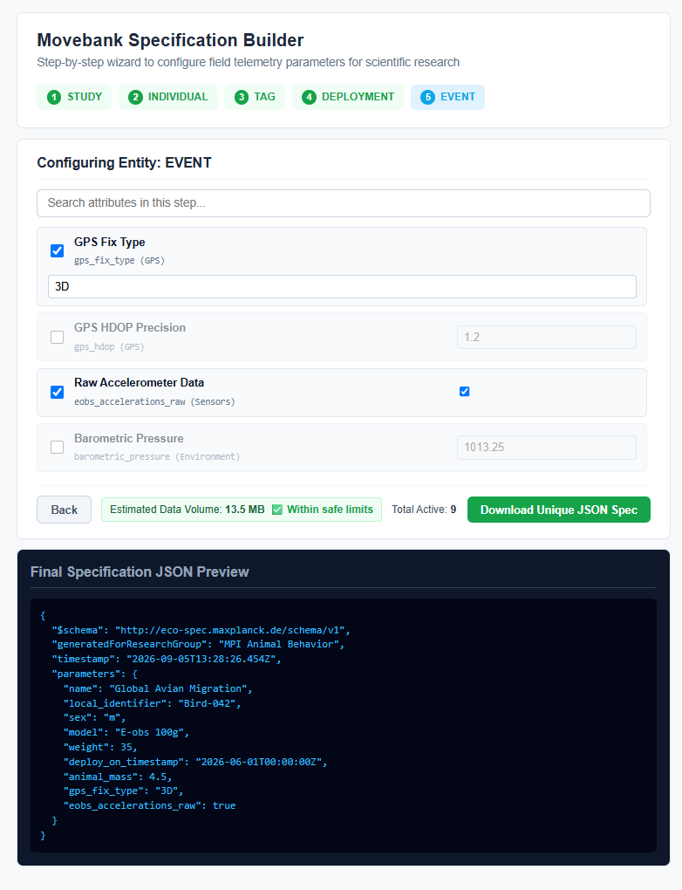

# Specification Builder

High-performance, responsive and maintainable ecological specification tool built for scientific research using modern Angular standards. Designed with a modular architecture, reactive signals and zero legacy bloat.

## Key Features

- Guided Multi-Step Wizard: Traverses the core Movebank entity hierarchy sequentially: study, individual, tag, deployment, and event.

- Modern Reactive State: Built natively on Angular Signals (signal, computed, inject()) for predictable, high-performance state management without boilerplate overhead.

- Real-Time Data Volume Estimation: Dynamically computes expected storage footprints based on active parameter counts and triggers safe-limit visual warnings.

- Granular Field Validation: Enforces per-attribute numeric range rules (min/max) and blocks navigation or export until step-level criteria are satisfied.

- Adaptive Responsive Design: Compact grid layout with intelligent field scaling, automatically expanding text inputs (like study names and descriptions) into comfortable full-width blocks.

- Instant JSON Export: Compiles active parameters into a structured specification schema for direct browser-side blob downloading.



## 🚀 Live Demo

🔗 **[View Live Application on Cloudflare Pages](https://eco-spec.pages.dev/)**

## Tech Stack

- Framework: this project was generated using [Angular CLI](https://github.com/angular/angular-cli) version 22.1.6 (Standalone components, Signals)

- Styling: Custom modular SCSS with mobile-first fluid scaling

- Separation of Concerns: Thin component architecture that delegates business rules, validation logic, and state mutations entirely to the core BuilderService.

## Project Structure

```text
src/
└── app/
    ├── core/
    │   ├── models/         # Movebank hierarchy configurations and TypeScript interfaces
    │   └── services/       # Core business logic and reactive state management (BuilderService)
    └── features/
        └── builder/        # Wizard UI component, templates and adaptive styling
```

## Development server

To start a local development server, run:

```bash
ng serve
```

Once the server is running, open your browser and navigate to `http://localhost:4200/`. The application will automatically reload whenever you modify any of the source files.

## Code scaffolding

Angular CLI includes powerful code scaffolding tools. To generate a new component, run:

```bash
ng generate component component-name
```

For a complete list of available schematics (such as `components`, `directives`, or `pipes`), run:

```bash
ng generate --help
```

## Building

To build the project run:

```bash
ng build
```

This will compile your project and store the build artifacts in the `dist/` directory. By default, the production build optimizes your application for performance and speed.

## Running unit tests

To execute unit tests with the [Vitest](https://vitest.dev/) test runner, use the following command:

```bash
ng test
```

## Running end-to-end tests

For end-to-end (e2e) testing, run:

```bash
ng e2e
```

Angular CLI does not come with an end-to-end testing framework by default. You can choose one that suits your needs.

## Additional Resources

For more information on using the Angular CLI, including detailed command references, visit the [Angular CLI Overview and Command Reference](https://angular.dev/tools/cli) page.

## 📄 License

[](https://opensource.org/licenses/MIT)

- This project is open-source and available under the [MIT License](./LICENSE).
