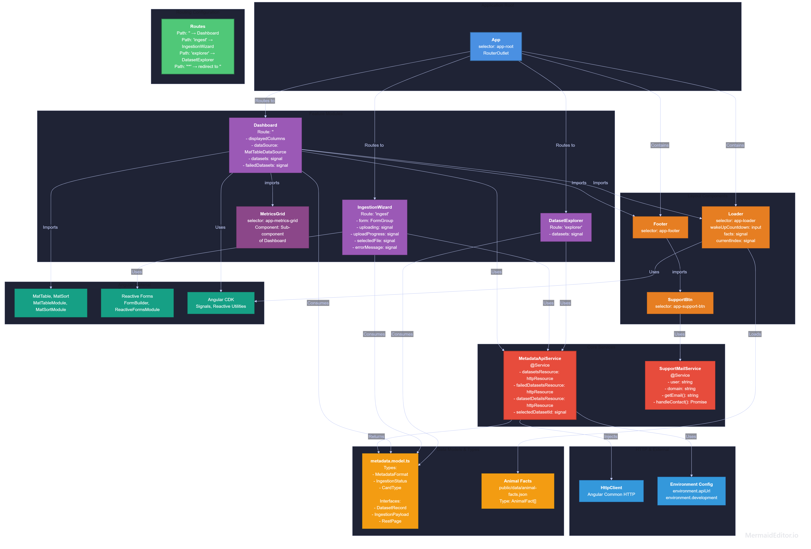

# Ecological Metadata Harvester & Ingestion Gateway (Frontend)

An enterprise-grade Angular administrative dashboard and ingestion wizard. It interfaces directly with the backend ecosystem to manage metadata records, process scientific file uploads and display system telemetry metrics.

This app is a part of the [@ecosystem](../../README.md) monorepo.

## 🚀 Live Demo

🔗 **[View Live Application on Cloudflare Pages](https://metadata-harvester.pages.dev)**

## 🚀 Tech Stack

- Framework & Core: Angular (Standalone Components, Signals, Reactive Forms, Modern Control Flow) version 22.0.0

- UI Components: Angular Material 22.1.3

- Language: TypeScript 6.0.2

- Styling: Global styles.scss with component-scoped SCSS stylesheets

- State Management & Communication: Angular HttpClient with proxy configuration, reactive signals, and declarative httpResource fetching

- Testing: Vitest 4.0.8

## 🏛️ System Architecture

<p align="center">
  
</p>

> _Tip: You can also inspect the raw diagram source code in [ARCHITECTURE.mmd](ARCHITECTURE.mmd)._

## 📁 Project Structure

```text
src/
├── app/
│   ├── core/
│   │   ├── models/
│   │   │   └── metadata.model.ts      # TypeScript interfaces & types (DatasetRecord, IngestionPayload, etc.)
│   │   └── services/
│   │       ├── metadata-api.service.ts # REST API gateway integration using httpResource
│   │       └── support-mail.service.ts # Email obfuscation, clipboard copy, and mailto handling
│   ├── features/
│   │   ├── dashboard/                 # System metrics & recent ingestion logs
│   │   ├── ingestion/                 # Multi-format telemetry upload wizard
│   │   ├── explorer/                  # DSpace collection/item repository explorer
│   │   └── powered/                   # Attribution and credits page
│   ├── app.component.ts
│   ├── app.config.ts                  # Global app providers & HttpClient setup
│   └── app.routes.ts                  # Lazy/direct route definitions
├── index.html
└── styles.scss                        # Global root CSS styles & variables
```

## 🌟 Core Features & Routes

- / — Dashboard: Real-time visibility tracking total datasets, successful metadata harvests, and validation error statistics.

- /ingest — Ingestion Wizard: Supports multi-format scientific file uploads including Movebank XML, Darwin Core Archives (DwC-A), and JSON Schemas, mapping them directly to target collections.

- /explorer — Dataset Explorer: Inspect harvested metadata records, view structural status, search, filter, and diagnose error payloads.

- /powered — Powered By: Attribution and technology credits page.

## Data Flow & State Management

The application leverages Angular's modern reactivity primitives:

```Plaintext
User Action → Router → Feature Component → Service → HttpClient → Proxy → Backend API → Response → HttpResource → Signal → Template
```

- Reactive Signals: Built-in signal() handles component-level local state.

- HttpResource: Provides declarative, reactive resource fetching for asynchronous API data integration.

- RxJS: Manages complex asynchronous event streams where applicable.

### 🔗 **API Endpoints**

| Method | Endpoint                                  | Purpose                 |
| ------ | ----------------------------------------- | ----------------------- |
| GET    | `/api/v1/datasets`                        | Fetch all datasets      |
| GET    | `/api/v1/datasets/{id}`                   | Fetch dataset details   |
| GET    | `/api/v1/metrics/failed-validations/list` | Get validation failures |
| POST   | `/api/v1/ingest`                          | Upload new dataset      |

### 🌍 **Environment Configuration**

- **Production**: `https://metadata-harvester-backend.onrender.com/api/v1`
- **Development**: `http://localhost:8080/api/v1`

## 🛠️ Getting Started

For installation instructions and prerequisites, see the **Getting Started** section of [@ecosystem](../../README.md).

## Configure API Endpoint

Verify or update the base URL in your service file if your Spring Boot backend runs on a different port or host:

```text
Path: src/app/core/services/metadata-api.service.ts

Default: http://localhost:8080/api/v1/metadata
```

## Development

To run this application locally for development, use the Nx task runner from the repository root:

```bash
# Run development server with live reload
npx nx serve metadata-harvester

# Or run it with a specific configuration
npx nx serve metadata-harvester --configuration=production
```

## Build

To build the production bundle for this specific application:

```bash
npx nx build metadata-harvester
```

## Testing

```bash
# Run unit tests
npx nx test metadata-harvester

# Run lint checks
npx nx lint metadata-harvester
```

## 🤝 Contributing

Contributions, issues and feature requests are welcome! Feel free to check the [issues page](hhttps://github.com/wixhub/ecosystem/issues).

## 📬 Contact & Support

If you have any questions, suggestions, or feedback regarding this project, feel free to reach out:

- **Author:** [@wixhub](https://github.com/wixhub)
- **Telegram:** [@typeweb](https://t.me/typeweb)

## 📄 License

[](https://opensource.org/licenses/MIT)

- This project is open-source and available under the [**MIT License**](../../LICENSE).
