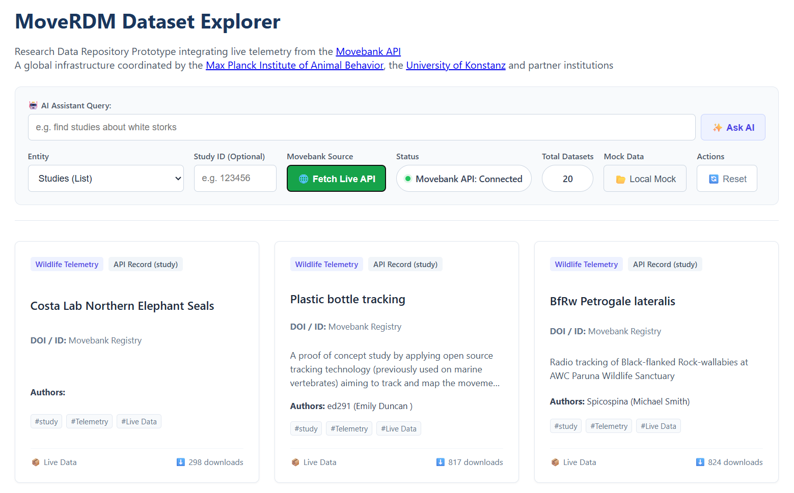
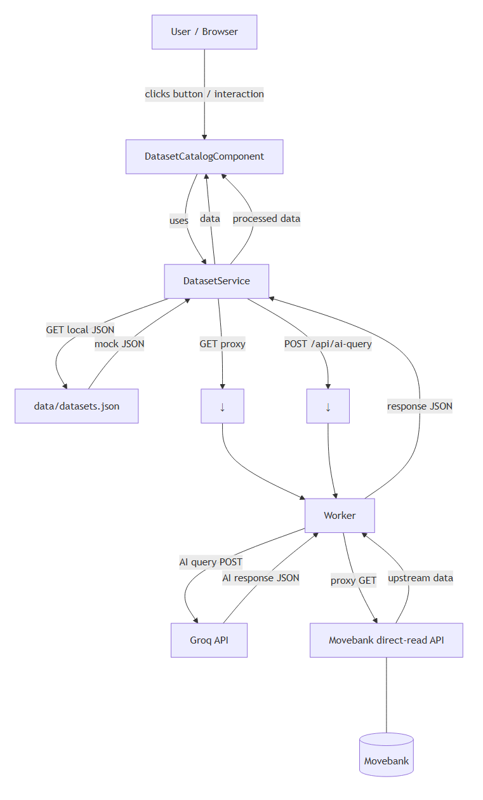

# 🌐 MoveRDM Dataset Explorer

### Research Data Repository Frontend

A high-performance, fully responsive web application built as a frontend prototype for ecological and behavioral research data repositories within the **MoveRDM** initiative. It integrates with the **[Movebank API](https://www.movebank.org/)** — a global infrastructure coordinated by the [Max Planck Institute of Animal Behavior](https://www.ab.mpg.de/), the [University of Konstanz](https://www.uni-konstanz.de/) and partner institutions.

[](https://angular.io/)
[](https://www.typescriptlang.org/)
[](https://sass-lang.com/)
[](https://groq.com/)
[](https://movebank-explorer.pages.dev)

[](https://www.movebank.org/)
[](https://movebank-explorer.pages.dev)

[](https://pages.cloudflare.com/)
[](https://wispy-surf-c9db.rublin.workers.dev/)

[](https://www.ab.mpg.de/)
[](https://www.uni-konstanz.de/)

## 📌 About the Project

This project simulates a production-ready interface for browsing, querying and managing complex scientific datasets and metadata structures, bridging local mock storage with real-time telemetry streams from [Movebank](https://www.movebank.org/)

This app is a part of the [@ecosystem](../../README.md) monorepo.

## 📖 Overview

**MoveRDM** is an advanced research data repository prototype built for ecological and behavioral telemetry data, featuring live integration with the **Movebank API**. The application bridges the gap between static local mock data storage and real-time scientific data streaming via a secure cloud proxy architecture.

## 🚀 Live Demo

🔗 **[View Live Application on Cloudflare Pages](https://movebank-explorer.pages.dev)**



## 🏛️ Project Architecture

<p align="center">
  
</p>

> _Tip: You can also inspect the raw diagram source code in [ARCHITECTURE.MMD](architecture-diagram.mmd)._

## ✨ Key Features

- **Dual Data Sources:** Seamlessly toggle between local static mock datasets and live real-time telemetry streams.
- **Dynamic Query Builder:** Interact directly with multiple Movebank entities (`study`, `tag_type`, `taxon`, `deployment`) with optional custom `study_id` filters.
- **AI Assistant Query:** Natural language search bar ("e.g., find studies about white storks") powered by Groq, turning conversational prompts into structured filter parameters on the fly.
- **CORS & Auth Proxy:** Built on top of **Cloudflare Workers** to safely inject API credentials and handle cross-origin restrictions gracefully.
- **Client-Side CSV/TSV Parser:** Efficiently parses raw text/CSV data streams coming from upstream scientific endpoints into reactive Angular models on the fly.
- **Robust Error Handling:** Automatically clears previous results and displays clean notifications if live queries return empty datasets or fail.
- **Modern UI/UX:** Fully responsive card grid layout tailored for researchers, featuring real-time loading states and optimized mobile views.

## 🛠️ Technology Stack

- **Frontend:** This project was generated using [Angular CLI](https://github.com/angular/angular-cli) version 22.0.7 (Standalone Components, Signals, Reactive Forms, HttpClient)
- **Styling:** SCSS (Fully Responsive Flex/Grid Layouts, Custom Color Palettes)
- **Backend / Middleware:** Cloudflare Workers (TypeScript, Fetch API, Basic Auth Injection)
- **AI & Intelligence:** Groq API (High-performance LLM inference integrated into the backend proxy for natural language dataset querying).
- **Data Format:** JSON (Local Mock) & TSV/CSV (Live Movebank Direct-Read Stream)

## 🌐 Data Source & Backend Proxy

- **Cloudflare Worker Integration**: The application utilizes a dedicated serverless worker as an online data source and API proxy. It securely fetches data from the Movebank API, handles CORS limitations and parses raw CSV responses into strongly-typed data models.

- **Backend Endpoint**: 🔗 **[View Worker on Cloudflare Workers](https://wispy-surf-c9db.rublin.workers.dev/)**

- **Data Attribution**: Data is accessed via the **[Movebank API](www.movebank.org)** and provided by individual study contributors.

## ⚙️ Cloudflare Worker Setup

To enable live data fetching without CORS or security issues, deploy the backend proxy worker:

1. Navigate to the backend directory:

```bash
cd backend/wispy-surf-c9db
```

2. Configure your environment secrets in Cloudflare:

```bash
npx wrangler secret put MOVEBANK_USERNAME
npx wrangler secret put MOVEBANK_PASSWORD
npx wrangler secret put GROQ_API_KEY
```

3. Deploy the worker to your Cloudflare account:

```bash
npx wrangler deploy
```

## 🛠️ Getting Started

For installation instructions and prerequisites, see the **Getting Started** section of [@ecosystem](../../README.md).

## Development

To run this application locally for development, use the Nx task runner from the repository root:

```bash
# Run development server with live reload
npx nx serve movebank-explorer

# Or run it with a specific configuration
npx nx serve movebank-explorer --configuration=production
```

## Build

To build the production bundle for this specific application:

```bash
npx nx build movebank-explorer
```

## Testing

```bash
# Run unit tests
npx nx test movebank-explorer

# Run lint checks
npx nx lint movebank-explorer
```

## 🤝 Contributing

Contributions, issues and feature requests are welcome! Feel free to check the [issues page](hhttps://github.com/wixhub/ecosystem/issues).

## 📬 Contact & Support

If you have any questions, suggestions, or feedback regarding this project, feel free to reach out:

- **Author:** [@wixhub](https://github.com/wixhub)
- **Telegram:** [@typeweb](https://t.me/typeweb)

## 📄 License

[](https://opensource.org/licenses/MIT)

- This project is open-source and available under the [**MIT License**](../../LICENSE).
