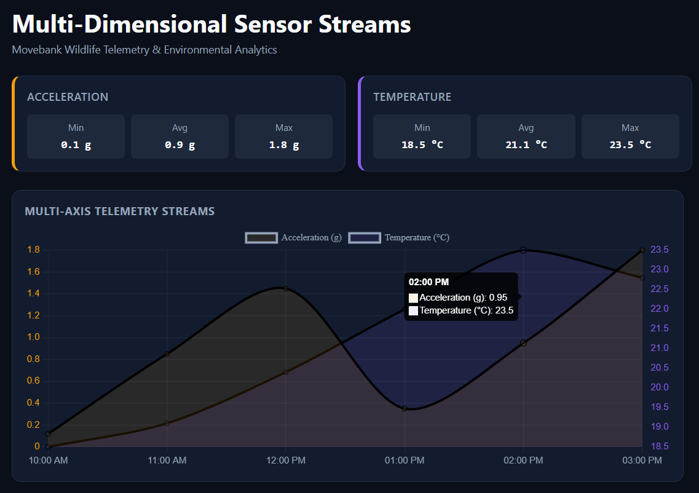

# Multi-Dimensional Sensor Streams Dashboard

A production-grade scientific dashboard designed for visualizing complex multi-dimensional animal tracking and environmental telemetry streams sourced from **Movebank**. Built using **Angular 22** featuring native Signals, stable Zoneless architecture, and modern reactive forms.

This app is a part of the [@ecosystem](../../README.md) monorepo.



## 🚀 Live Demo

🔗 **[View Live Application on Cloudflare Pages](https://sensor-streams.pages.dev)**

## Key Features

1. **Zoneless & Signal-Powered**: Fully optimized for Angular 22 reactivity standards, executing performant computed state updates without Zone.js overhead.

2. **Synchronized Time-Series Charting**: Integrated multi-axis graphs handling high-frequency sensor streams (Acceleration and Temperature) via Chart.js.

3. **Responsive Grid Layouts**: Fluid layout mechanism featuring CSS grid and custom SCSS mixins that reflow seamlessly from multi-column desktop monitors down to mobile single-column layouts.

4. **Adaptive Statistical Cards**: Real-time evaluation of sensor arrays displaying precise minimum, maximum, and average indicators.

This project was generated using [Angular CLI](https://github.com/angular/angular-cli) version 22.1.3.

## Project Structure

```text
sensor-streams/
├── public/
│   └── data/
│       └── sensor-streams.json
├── src/
│   ├── app/
│   │   ├── core/
│   │   │   ├── services/
│   │   │   │   └── movebank.service.ts
│   │   │   └──  models/
│   │   │       └── sensor.model.ts
│   │   ├── features/
│   │   │   ├── dashboard/
│   │   │   │   ├── dashboard.component.ts
│   │   │   │   ├── dashboard.component.scss
│   │   │   │   └── dashboard.component.html
│   │   │   ├── stat-card/
│   │   │   │   ├── stat-card.component.ts
│   │   │   │   └── stat-card.component.scss
│   │   │   └── sensor-chart/
│   │   │       ├── sensor-chart.component.ts
│   │   │       └── sensor-chart.component.scss
│   │   ├── app.config.ts
│   │   ├── app.component.ts
│   │   └── app.component.html
│   ├── styles.scss
│   └── main.ts
├── angular.json
├── package.json
└── README.md
```

## 🛠️ Getting Started

For installation instructions and prerequisites, see the **Getting Started** section of [@ecosystem](../../README.md).

## Development

To run this application locally for development, use the Nx task runner from the repository root:

```bash
# Run development server with live reload
npx nx serve sensor-streams

# Or run it with a specific configuration
npx nx serve sensor-streams --configuration=production
```

## Build

To build the production bundle for this specific application:

```bash
npx nx build sensor-streams
```

## Testing

```bash
# Run unit tests
npx nx test sensor-streams

# Run lint checks
npx nx lint sensor-streams
```

## 🤝 Contributing

Contributions, issues and feature requests are welcome! Feel free to check the [issues page](hhttps://github.com/wixhub/ecosystem/issues).

## 📬 Contact & Support

If you have any questions, suggestions, or feedback regarding this project, feel free to reach out:

- **Author:** [@wixhub](https://github.com/wixhub)
- **Telegram:** [@typeweb](https://t.me/typeweb)

## 📄 License

[](https://opensource.org/licenses/MIT)

- This project is open-source and available under the [**MIT License**](../../LICENSE).
