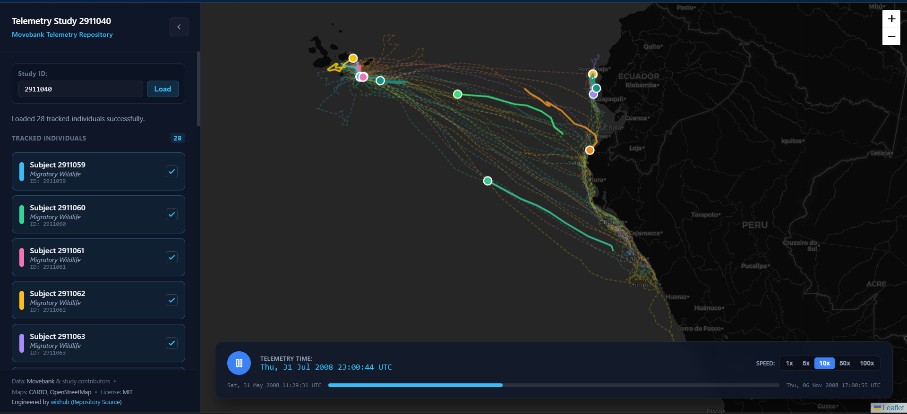

# Spatial-Temporal Migration Playback



## Movebank Data Repository & Animal Tracking

A high-performance scientific web application built with Angular 22 (with Signals), TypeScript, Leaflet.js and SCSS for interactive playback and visualization of animal migration telemetry over geographical map layers.

This app is a part of the [@ecosystem](../../README.md) monorepo.

## 🚀 Live Demo

🔗 **[View Live Application on Cloudflare Pages](https://spatial-temporal.pages.dev)**

## 🚀 Key Features

- Interactive Map Integration (Leaflet.js): Responsive map viewport rendering historical migration paths (polylines) and real-time interpolated animal position markers based on geographic coordinates (latitude, longitude, timestamp).

- Timeline Playboard & Controls: Custom timeline controller featuring Play, Pause, Scrubbing (seek bar) and Speed Scaling ($1\times, 5\times, 10\times, 50\times$) to animate telemetry playback smoothly across temporal horizons.

- Angular Signals State Management: Reactive state handling powered by Angular Signals for tracking current playback time, active datasets, selected animal individuals and speed scaling.

- Movebank Data Service & Mock Mode: Robust data layer supporting Movebank CSV/JSON payload formats with a built-in mock dataset mode for offline development and testing.

- Scientific Dashboard Layout: Sleek collapsible sidebar for filtering individuals/species, telemetry metadata inspection and a full-viewport map container.

## 📁 Project Architecture

```text
src/
├── app/
│   ├── core/
│   │   ├── layout/
│   │   │   ├── shell/                # Main application shell layout
│   │   │   └── sidebar/              # Collapsible sidebar for filtering & metadata
│   │   ├── models/
│   │   │   └── telemetry.model.ts    # Interfaces for telemetry, tracks and individuals
│   │   └── services/
│   │       └── migration.service.ts  # Data parsing, Movebank integration and signal state
│   ├── features/
│   │   ├── map-view/                 # Leaflet.js map component & marker management
│   │   ├── timeline/                 # Play/pause, scrubbing and speed scaling controls
│   │   └── powered/                  # Metadata & status indicators
│   ├── app.component.ts              # Main layout coordinator
│   ├── app.component.html
│   ├── app.component.scss
│   └── app.config.ts                 # Application configuration (zoneless/providers)
├── styles.scss                       # Global design system & Leaflet CSS imports
└── index.html
```

## Data Source & Backend Proxy

- **Cloudflare Worker Integration**: The application utilizes a dedicated serverless worker as an online data source and API proxy. It securely fetches live telemetry streams from the Movebank API, handles CORS limitations and parses raw CSV responses into strongly-typed data models.

- **Backend Endpoint**: 🔗 **[View Worker on Cloudflare Workers](https://wispy-surf-c9db.rublin.workers.dev/)**

- **Data Attribution**: Telemetry data is accessed via the **[Movebank API](www.movebank.org)** and provided by individual study contributors. Map tiles are powered by **CARTO** under CC BY 3.0, utilizing data from **OpenStreetMap** contributors.

## 🛠️ Tech Stack

- **Framework**: This project was generated using [Angular CLI](https://github.com/angular/angular-cli) version 22.1.3.

- **Language**: TypeScript

- **Mapping Library**: Leaflet.js & @types/leaflet

- **Styling**: SCSS with modern CSS Grid/Flexbox layouts

- **Build Tool**: Angular CLI

## 🛠️ Getting Started

For installation instructions and prerequisites, see the **Getting Started** section of [@ecosystem](../../README.md).

## ⚙️ Configuration & Environment

To run this application locally, you need to provide configuration keys for map tiles [CARTO](https://carto.com/basemaps/apikey/).

1. Copy the example environment configuration file located in `libs/config/src/`:

```bash
cp libs/config/src/carto.config.example.ts libs/config/src/carto.config.ts
```

2. Open `libs/config/src/carto.config.ts` and insert your personal CARTO API key:

```typescript
export const CARTO_API_KEY = 'YOUR_CARTO_API_KEY';
```

> [!NOTE]
> `carto.config.ts` is ignored by Git to keep API keys secure, while `carto.config.example.ts` serves as the public template.

## Development

To run this application locally for development, use the Nx task runner from the repository root:

```bash
# Run development server with live reload
npx nx serve spatial-temporal

# Or run it with a specific configuration
npx nx serve spatial-temporal --configuration=production
```

## Build

To build the production bundle for this specific application:

```bash
npx nx build spatial-temporal
```

## Testing

```bash
# Run unit tests
npx nx test spatial-temporal

# Run lint checks
npx nx lint spatial-temporal
```

## 🤝 Contributing

Contributions, issues and feature requests are welcome! Feel free to check the [issues page](hhttps://github.com/wixhub/ecosystem/issues).

## 📬 Contact & Support

If you have any questions, suggestions, or feedback regarding this project, feel free to reach out:

- **Author:** [@wixhub](https://github.com/wixhub)
- **Telegram:** [@typeweb](https://t.me/typeweb)

## 📜 License

- **Software License**: This project is open-source software licensed under the [**MIT License**](./LICENSE).

- **Data & Map Attribution**:
  - Animal tracking data provided by [**Movebank**](www.movebank.org) and individual researchers.

  - Map tiles by [**CARTO**](https://carto.com/), under CC BY 3.0. Data by **OpenStreetMap** contributors.
